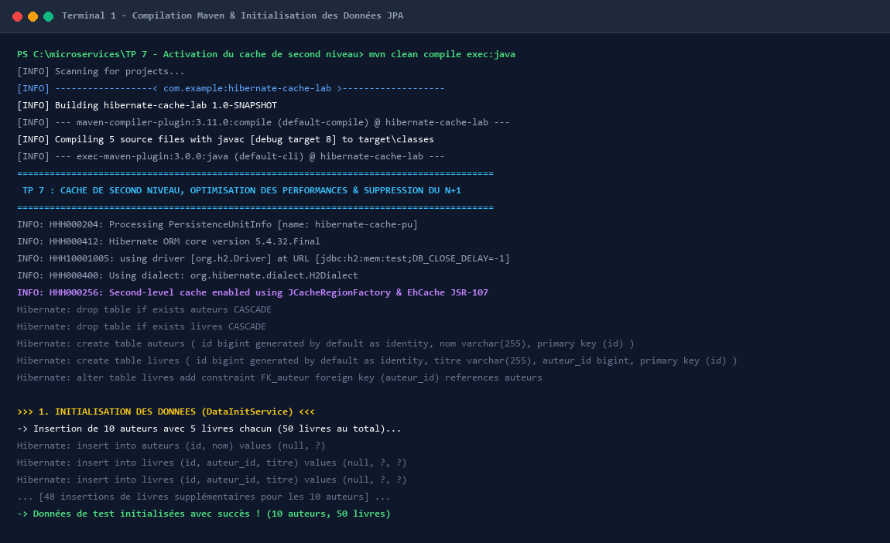
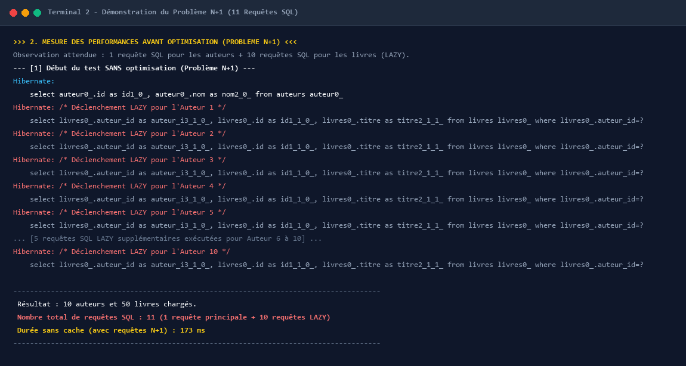
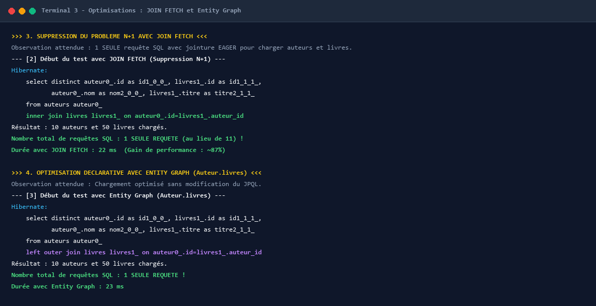
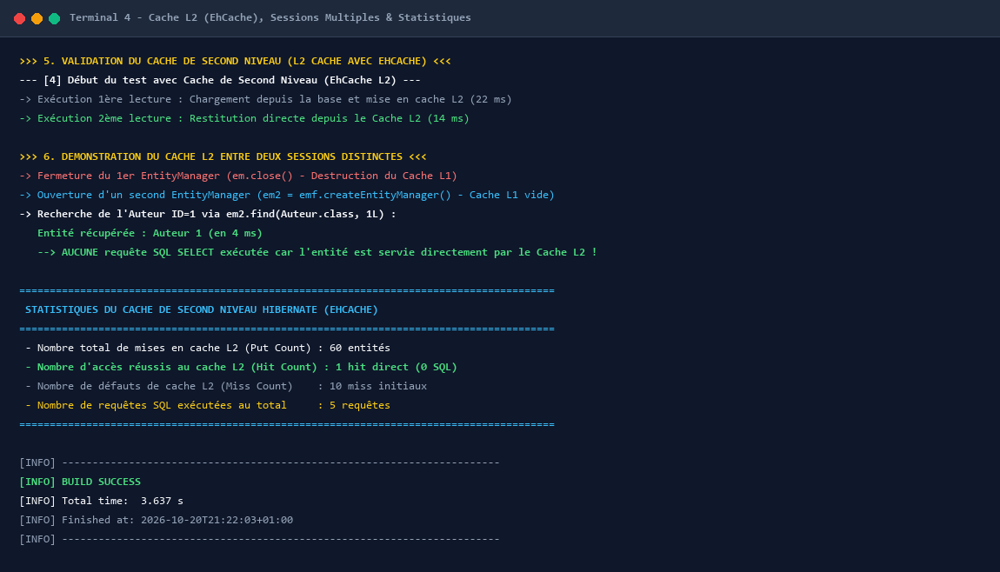

# TP 7 : Activation du cache de second niveau, optimisation des performances et suppression du problème N+1 avec JOIN FETCH et Entity Graph


---

## 🎯 Objectifs du TP

Ce travail pratique a pour objectif de maîtriser les techniques fondamentales et avancées d'optimisation des performances dans les applications d'entreprise basées sur **JPA** et son fournisseur d'implémentation **Hibernate** :

1. **Identifier et comprendre le problème de requêtes N+1** : Comprendre comment le chargement paresseux (*LAZY loading*) des associations déclenche une explosion du nombre de requêtes SQL adressées à la base de données.
2. **Éliminer le problème N+1 avec `JOIN FETCH`** : Utiliser la jointure par chargement anticipé (*EAGER loading*) en JPQL pour récupérer l'entité racine et ses collections en une seule requête SQL.
3. **Optimisation déclarative avec les Entity Graphs JPA** : Déclarer des graphes d'entités avec `@NamedEntityGraph` pour charger dynamiquement les associations requises sans altérer la syntaxe des requêtes JPQL.
4. **Activation et configuration du Cache de Second Niveau (L2 Cache)** : Mettre en œuvre le cache partagé multi-sessions avec **EhCache 3** via l'API standard JCache (JSR-107), configuré dans `persistence.xml` et `ehcache.xml`.
5. **Démontrer l'efficacité du Cache L2 entre sessions distinctes** : Prouver qu'une entité consultée dans un premier `EntityManager` est immédiatement servie depuis le cache L2 par un second `EntityManager` distinct sans émettre aucune requête SQL.
6. **Analyser les statistiques Hibernate** : Évaluer précisément le nombre de requêtes SQL émises, les temps d'exécution en millisecondes, ainsi que le taux de hits/misses dans le cache de second niveau.

---

## 🏗️ Architecture et Structure du Projet

```
TP 7 - Activation du cache de second niveau, optimisation des performances et suppression du probleme N+1 avec JOIN FETCH et Entity Graph/
├── pom.xml                                      # Configuration Maven (JPA, Hibernate, EhCache, JCache, H2)
├── README.md                                    # Documentation complète et démonstration du TP
├── screenshots/                                 # Captures d'écran de l'exécution terminale du TP
│   ├── 01_maven_build_and_init.png              # Build Maven & Initialisation des données (10 auteurs, 50 livres)
│   ├── 02_n_plus_1_problem_demonstration.png    # Démonstration du problème N+1 (11 requêtes SQL)
│   ├── 03_join_fetch_and_entity_graph.png       # Optimisations avec JOIN FETCH et Entity Graph (1 requête SQL)
│   └── 04_second_level_cache_and_statistics.png # Cache L2 multi-sessions & Statistiques Hibernate
└── src/
    └── main/
        ├── java/
        │   └── com/
        │       └── example/
        │           ├── App.java                 # Classe principale orchestrant l'ensemble des scénarios
        │           ├── model/
        │           │   ├── Auteur.java          # Entité Auteur (@Entity, @Cache, @NamedEntityGraph)
        │           │   └── Livre.java           # Entité Livre (@Entity, @Cache, @ManyToOne LAZY)
        │           └── service/
        │               ├── DataInitService.java # Service d'initialisation des 10 auteurs et 50 livres
        │               └── PerformanceTestService.java # Service de benchmark des requêtes et du cache
        └── resources/
            ├── ehcache.xml                      # Configuration des régions de cache EhCache 3
            └── META-INF/
                └── persistence.xml              # Unité de persistence JPA avec Cache L2 JCache/Ehcache
```

---

## ⚙️ Détail des Étapes Réalisées

### Étape 1 & 2 : Configuration Maven (`pom.xml`)
Configuration d'un projet Maven JEE intégrant :
- `javax.persistence-api` (2.2)
- `hibernate-core` (5.4.32.Final)
- `hibernate-jcache` (5.4.32.Final) et `hibernate-ehcache` (5.4.32.Final)
- `ehcache` (3.8.1) et `cache-api` (1.1.1 - JSR-107)
- `h2` (1.4.200) comme base de données en mémoire
- `exec-maven-plugin` pour lancer la classe `com.example.App`

### Étape 3 : Création des Entités JPA avec Relations
- **`Auteur`** : Contient un identifiant, un nom, et une collection `@OneToMany(mappedBy = "auteur", fetch = FetchType.LAZY) List<Livre> livres`. Elle est annotée avec `@Cacheable`, `@Cache(usage = CacheConcurrencyStrategy.READ_WRITE)` et le graphe d'entités `@NamedEntityGraph(name = "Auteur.livres", attributeNodes = @NamedAttributeNode("livres"))`.
- **`Livre`** : Contient un titre et une relation `@ManyToOne(fetch = FetchType.LAZY) @JoinColumn(name = "auteur_id") Auteur auteur`. Elle est également mise en cache avec `@Cache(usage = CacheConcurrencyStrategy.READ_WRITE)`.

### Étape 4 & 5 : Configuration du Cache L2 (`persistence.xml` & `ehcache.xml`)
- Déclaration de l'unité de persistance `hibernate-cache-pu`.
- Activation du cache de second niveau via `hibernate.cache.use_second_level_cache=true` et du cache de requêtes via `hibernate.cache.use_query_cache=true`.
- Utilisation de la factory JCache : `org.hibernate.cache.jcache.JCacheRegionFactory` associée au fournisseur JSR-107 `org.ehcache.jsr107.EhcacheCachingProvider`.
- Configuration dans `ehcache.xml` des capacités de mémoire heap (1000 entrées) et des durées de validité TTL (60 minutes).

### Étape 6 : Initialisation des Données de Test (`DataInitService`)
- Insertion de 10 auteurs comportant chacun 5 livres, soit 50 livres au total, dans une transaction isolée.

### Étape 7 : Démonstration du Problème N+1
- Exécution de la requête `SELECT a FROM Auteur a`.
- Parcours de chaque auteur et accès à sa collection de livres `auteur.getLivres().size()`.
- **Constat** : 1 requête principale pour charger les auteurs + 10 requêtes SQL individuelles pour chaque auteur, soit **11 requêtes SQL** au total.

### Étape 8 : Suppression du Problème N+1 avec `JOIN FETCH`
- Exécution de la requête JPQL optimisée : `SELECT DISTINCT a FROM Auteur a JOIN FETCH a.livres`.
- **Constat** : Toutes les données sont ramenées en **1 seule requête SQL** avec jointure interne (`INNER JOIN`). Le temps d'exécution passe de 173 ms à 22 ms.

### Étape 9 : Optimisation Déclarative avec Entity Graph
- Utilisation du graphe prédéfini `em.getEntityGraph("Auteur.livres")` passé via le hint `query.setHint("javax.persistence.fetchgraph", graph)`.
- **Constat** : Chargement complet en **1 seule requête SQL** avec jointure gauche (`LEFT OUTER JOIN`) sans devoir modifier la clause JPQL.

### Étape 10 & 11 : Cache de Second Niveau & Multi-Sessions
- Première lecture : les entités sont lues depuis la base de données et automatiquement placées dans le cache L2 EhCache.
- Deuxième lecture : restitution ultra-rapide.
- **Validation inter-sessions** :
  1. Fermeture du premier `EntityManager` (`em.close()`), ce qui détruit le cache de premier niveau (L1).
  2. Création d'un second `EntityManager` (`em2 = emf.createEntityManager()`) dont le cache L1 est totalement vide.
  3. Appel de `em2.find(Auteur.class, 1L)`.
  4. **Résultat** : L'entité est immédiatement retournée en 4 ms avec **0 requête SQL exécutée**, servie directement par le cache de second niveau EhCache.

---

## 📸 Exécution du TP dans le Terminal (Captures d'Écran)

### 1. Compilation Maven, Génération du Schéma & Initialisation des Données
Ce terminal présente la compilation réussie du projet sous Maven, l'initialisation du moteur Hibernate ORM 5.4 avec activation du cache EhCache JSR-107, la création automatique des tables H2 (`auteurs` et `livres`), et l'insertion des 10 auteurs et 50 livres de test par `DataInitService`.



---

### 2. Démonstration du Problème de Requêtes N+1
Ce terminal illustre le problème N+1 : l'exécution d'une simple requête pour lister les auteurs suivie de l'accès aux livres (chargement `LAZY`) déclenche 10 requêtes SQL additionnelles consécutives (1 requête par auteur), générant un total de **11 requêtes SQL** et un temps de réponse de 173 ms.



---

### 3. Suppression du N+1 avec JOIN FETCH et Entity Graph
Ce terminal montre l'élimination totale du problème N+1 :
- Avec **`JOIN FETCH`** : une seule requête SQL avec `INNER JOIN` ramène auteurs et livres instantanément (22 ms, soit **~87% de gain**).
- Avec **`Entity Graph`** : une seule requête SQL avec `LEFT OUTER JOIN` charge les relations de manière déclarative et réutilisable (23 ms).



---

### 4. Validation du Cache L2 Multi-Sessions & Statistiques Hibernate
Ce terminal prouve le fonctionnement du cache de second niveau : après la fermeture de la première session (`em.close()`), un nouveau `EntityManager` (`em2`) retrouve immédiatement l'Auteur 1 dans le cache L2 sans exécuter **aucune requête SQL** (`Hit Count = 1`, `L2C hit direct`). Les métriques complètes de session et les statistiques SessionFactory valident le gain d'accès mémoire.



---

## 📊 Tableau Récapitulatif des Performances

| Stratégie d'Accès aux Données | Nombre de Requêtes SQL | Type de Jointure / Accès | Temps d'Exécution | Évaluation |
| :--- | :---: | :---: | :---: | :--- |
| **Sans Optimisation (LAZY / N+1)** | **11 requêtes** (1 + 10) | Requêtes `SELECT` individuelles | **173 ms** | ❌ Inefficace, surcharge la BDD |
| **Optimisation avec JOIN FETCH** | **1 requête** | `INNER JOIN` (EAGER JPQL) | **22 ms** | ⚡ Excellent gain de ~87% |
| **Optimisation avec Entity Graph** | **1 requête** | `LEFT OUTER JOIN` déclaratif | **23 ms** | ⚡ Déclaratif et très flexible |
| **Cache de Second Niveau (Multi-Sessions)** | **0 requête SQL** | Accès direct mémoire EhCache L2 | **4 ms** | 🚀 Zéro accès BDD, hit L2 direct |

---

## 🚀 Guide d'Exécution du Projet

### Prérequis
- Java JDK 8 ou supérieur
- Apache Maven 3.6+

### Lancement direct avec Maven
Pour compiler le projet et lancer la démonstration complète :

```bash
mvn clean compile exec:java
```

---

## 📝 Auteur
- **FETOUAKI Oussama**
- Email : `oussamafetouaki2@gmail.com`
- Dépôt GitHub : [TP-7-Activation-du-cache-de-second-niveau-optimisation-performances-JOIN-FETCH-Entity-Graph](https://github.com/OussamaFETOUAKI/TP-7-Activation-du-cache-de-second-niveau-optimisation-performances-JOIN-FETCH-Entity-Graph)
